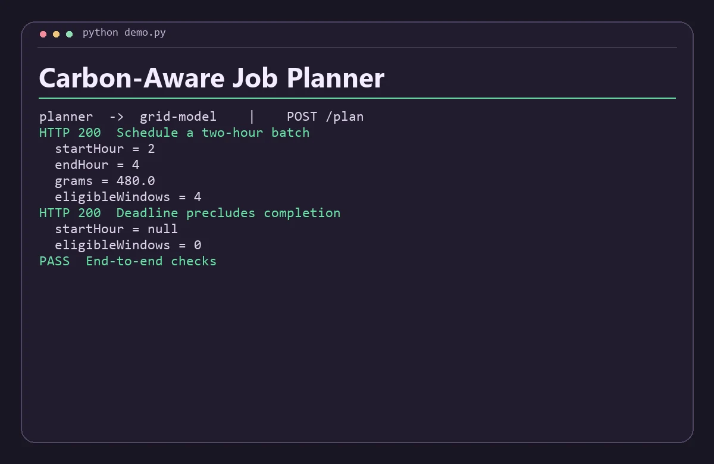

# Carbon-Aware Job Planner

Compare feasible batch-job start times against an hourly grid carbon forecast.



## Run the demo

Install Python 3.11+, .NET 8 SDK and runtime, then run this from the repository root.

```sh
python demo.py
```

The command starts both services on separate loopback ports, sends the requests in `examples.json`, checks the responses, and shuts down the processes. Use `python3` if that is how your system exposes Python.

## Run the services with Docker Compose

```sh
docker compose up -d --build
python demo.py --base-url http://127.0.0.1:8080
docker compose down
```

The API binds to loopback on port 8080 by default. Set `DEMO_PORT` and use the matching base URL to run another project alongside it. Set-up and service discovery follow the [Docker Compose networking documentation](https://docs.docker.com/compose/how-tos/networking/).

Both services are stateless and work with the data in each request. Start from fresh demo state before rerunning the scripted Compose checks.

## Architecture

Grid Model scores all contiguous windows of a requested duration using forecast grams CO2e per kWh. Planner filters candidates by deadline and ranks them by estimated emissions, then by earliest start.

| Service | Runtime | Operation |
| --- | --- | --- |
| `planner` | Python | Public demo API, `POST /plan` |
| `grid-model` | C# | Internal service, `POST /score` |

The two services exchange JSON over HTTP. Each has a `GET /health` endpoint for process readiness. Compose starts the API after the internal service passes its readiness probe. A gateway request returns HTTP 502 when its dependency is unavailable or fails unexpectedly. Invalid input returns HTTP 400. Domain conflicts return HTTP 409 where supported.

## API example

Send gridGPerKwh (consecutive hourly values starting at hour zero), hours, deadlineHour (exclusive end boundary) and kwhPerHour. The result is an estimate based on the caller's synthetic forecast.

From a running Compose stack, save this JSON as `input.json` and run the command below. On Windows use `curl.exe` if your shell aliases `curl`.

```json
{
  "gridGPerKwh": [
    420,
    390,
    180,
    140,
    230,
    380
  ],
  "hours": 2,
  "deadlineHour": 5,
  "kwhPerHour": 1.5
}
```

```sh
curl -s -H "Content-Type: application/json" --data-binary @input.json http://127.0.0.1:8080/plan
```

The response includes these fields.

```json
{
  "startHour": 2,
  "endHour": 4,
  "grams": 480,
  "eligibleWindows": 4
}
```

## Scope

This is a local portfolio project using synthetic data. The APIs are intended for loopback and the private Compose network. A public deployment would need authentication, rate limits, and production observability.
